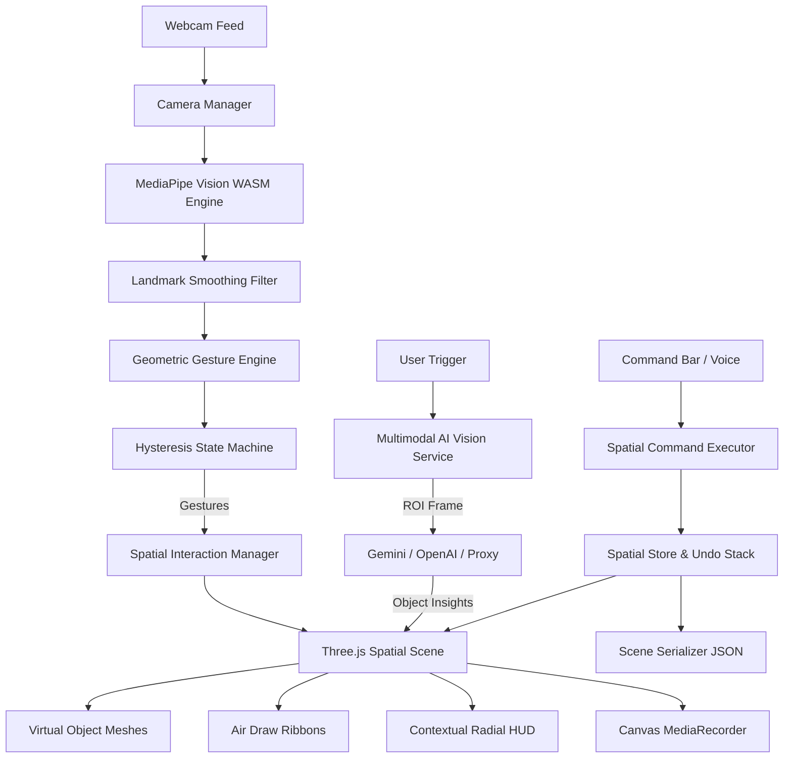

# Reality.exe — Production Spatial Computing & Computer Vision OS

[](LICENSE)
[](https://www.typescriptlang.org/)
[](https://threejs.org/)
[](https://developers.google.com/mediapipe)
[-brightgreen)](tests/)

> **"Reality is your interface."**  
> *Reality.exe is an interactive spatial computing operating system that connects the physical world with virtual 3D geometry and multimodal AI vision intelligence using natural hand gestures.*

---

## 🧭 Table of Contents

1. [Product Vision](#-product-vision)
2. [Key Capabilities & Features](#-key-capabilities--features)
3. [Live Interaction Showcase](#-live-interaction-showcase)
4. [Architecture & System Flow](#-architecture--system-flow)
5. [Technology Stack](#-technology-stack)
6. [Quick Start & Local Setup](#-quick-start--local-setup)
7. [Environment Configuration & AI Providers](#-environment-configuration--ai-providers)
8. [Automated Testing & Code Quality](#-automated-testing--code-quality)
9. [Production Deployment](#-production-deployment)
10. [Privacy & Security Audits](#-privacy--security-audits)
11. [Accessibility & Keyboard Alternatives](#-accessibility--keyboard-alternatives)
12. [Feature Roadmap](#-feature-roadmap)
13. [Contributing & License](#-contributing--license)

---

## 🌐 Product Vision

Traditional interfaces constrain digital information to flat 2D glass. **Reality.exe** transforms your room into an augmented spatial workspace. By streaming real-time optical frames through on-device WebAssembly neural models and rendering with WebGL 2.0, Reality.exe delivers sub-millimeter hand tracking, intuitive spatial object manipulation, 3D air-drawing, contextual radial HUDs, and multimodal physical object understanding—with zero hardware goggles required.

---

## ✨ Key Capabilities & Features

### 1. 21-Landmark Real-Time Neural Vision
- **MediaPipe Tasks Vision WASM**: Evaluates 21 3D hand coordinates at up to 60 FPS directly within local browser memory.
- **Adaptive Landmark Smoothing**: Velocity-sensitive Exponential Moving Average (EMA) and low-pass filtering eliminate micro-jitter while maintaining instantaneous responsiveness.
- **Hysteresis State Machine**: Gestures transition systematically through `NOT_DETECTED` ➔ `CANDIDATE` ➔ `RECOGNIZED` ➔ `HELD` ➔ `RELEASED` states to avoid rapid boundary toggling.

### 2. Spatial Desktop & Manipulation
- **6-DOF Direct Object Manipulation**: Grab, translate, scale, and rotate primitives (`cube`, `sphere`, `ring`, `octahedron`, `torus`, `cylinder`, `cone`).
- **Grab Offset Compensation**: Relative vector locking eliminates pointer jumping and preserves exact contact alignment.
- **Boundary Clamping & Frustum Safety**: Objects are guarded against clipping outside the visible spatial window.
- **Full History Stacks**: Multi-step **Undo** (`Ctrl+Z`) and **Redo** (`Ctrl+Y` / `Cmd+Shift+Z`) for all creation, translation, and deletion actions.

### 3. Multimodal Physical AI Vision
- **Reality Scan**: Point your finger at any real-world object in your room. Reality.exe captures a high-resolution region of interest (ROI) and queries multimodal AI vision models (Gemini / OpenAI) to project contextual 3D holographic insights into your workspace.
- **Ask Reality**: Inquire about your surroundings in natural language with visual ground truth.
- **Zero Background Streaming**: Camera frames are processed on-device and never transmitted to external cloud APIs unless explicitly triggered by the user.

### 4. Natural-Language Spatial Commands
- Speak or type intuitive commands via the bottom Command Bar:
  - `"spawn a glowing sphere"`
  - `"create three floating rings"`
  - `"make the selected object larger"`
  - `"rotate 45 degrees"`
  - `"duplicate object"`
  - `"reset scene"`
- Interpreted through a deterministic action parser without evaluating arbitrary or untrusted code strings.

### 5. Persistent Scene Snapshots (JSON)
- **Scene Export**: Save virtual workspaces as validated, portable `.json` files.
- **Scene Restoration**: Import and validate scene arrangements with strict schema checking, bounds normalization, and defense against prototype pollution.

### 6. In-Browser Canvas Screen Recording
- Capture 1080p WebM video demos directly using browser `MediaRecorder` APIs.
- Features real-time elapsed timer (`REC 00:14`), automatic file downloads, and zero cloud uploads.

### 7. Telemetry & Diagnostics HUD
- Real-time diagnostic overlays displaying inference latency (ms), tracking confidence (%), active gesture lifecycle stage, smoothing factors, and hand velocity.

---

## 🖐️ Live Interaction Showcase

| Interaction | Trigger Pose | Spatial Effect |
| :--- | :--- | :--- |
| **Pinch & Grab** | Thumb tip + Index tip pinch ($d < 0.052$) | 3D direct object translation with grab offset preservation |
| **Precision Pointer** | Extended Index finger pointing | Raycasts holographic targeting beam and surface glow |
| **Dual Hand Scale** | Bimanual pinch / distance delta | Uniformly scales virtual geometries between $0.3\times$ and $3.5\times$ |
| **Air Drawing** | Index finger drawing in mid-air | Generates smooth 3D Catmull-Rom neon light ribbons |
| **Air Circle** | Clockwise circular sweep ($\ge 300^\circ$) | Summons the Contextual Radial HUD at the fingertip |
| **Reality Scan** | Aim fingertip + tap Scan | Multimodal physical object recognition & 3D anchor |

---

## 🏛️ Architecture & System Flow



### Module Breakdown
- `src/core/cameraManager.ts`: Tiered resolution negotiation, active track disposal, and lifecycle management.
- `src/core/mediaPipeService.ts`: Local WASM HandLandmarker loader, concurrency locks, and EMA filters.
- `src/core/gestureEngine.ts`: Normalized anatomical 3D gesture classifier, cooldown timers, and gesture listeners.
- `src/spatial/spatialInteractionManager.ts`: Raycasting, grab offset tracking, and boundary containment.
- `src/spatial/sceneSerializer.ts`: Scene JSON export, import, prototype-pollution defenses, and coordinate clamping.
- `src/spatial/spatialCommandExecutor.ts`: Deterministic natural language command interpreter.
- `src/services/ai/`: Multimodal vision adapters for Google Gemini, OpenAI, Server Proxy, and offline Simulated models.
- `src/utils/canvasRecorder.ts`: Browser MediaStream canvas recording utility.

---

## 💻 Technology Stack

- **Frontend Core**: React 19, TypeScript 5.8 / 6.0
- **3D Graphics Engine**: Three.js (r182), React Three Fiber (`@react-three/fiber`), `@react-three/drei`
- **Computer Vision**: Google MediaPipe Tasks Vision WebAssembly (`@mediapipe/tasks-vision` v1.1.1)
- **Styling**: Tailwind CSS v4 + Vanilla CSS Cyberpunk Design Tokens
- **Icons**: Lucide React
- **Test Runner**: Node.js Native Test Runner (`node:test`) + `jiti` TypeScript executor
- **Linter**: Oxlint (Rust-based sub-millisecond linter)
- **Bundler**: Vite 8.3

---

## 🚀 Quick Start & Local Setup

### Prerequisites
- **Node.js**: v20.x or v22.x or v24.x
- **Browser**: Google Chrome 90+, Microsoft Edge 90+, Brave, or Firefox 110+ (WebGL 2.0 enabled)
- **Hardware**: Standard 720p or 1080p webcam

### 1. Clone the Repository
```bash
git clone https://github.com/MdKasif0/Reality-.-exe.git
cd Reality-.-exe
```

### 2. Install Dependencies
```bash
npm install
```

### 3. Launch Development Server
```bash
npm run dev
```
Open [http://localhost:5173](http://localhost:5173) in your browser.

---

## 🔑 Environment Configuration & AI Providers

Copy `.env.example` to `.env`:
```bash
cp .env.example .env
```

| Variable | Description | Default |
| :--- | :--- | :--- |
| `VITE_GEMINI_API_KEY` | Google Gemini API Key for client-side or proxy multimodal queries | Optional |
| `GEMINI_API_KEY` | Server-side Gemini API Key for proxy server | Optional |
| `VITE_OPENAI_API_KEY` | OpenAI API Key for GPT-4o multimodal vision | Optional |
| `PORT` | Local backend proxy server port | `3001` |

### Running with Backend Proxy (Zero Secret Exposure)
To keep API keys completely off client devices, run the included Node proxy:
```bash
npm run proxy
```

*Note: If no API keys are provided, Reality.exe automatically runs in high-fidelity **Simulated Mode**, enabling full testing of all AI spatial workflows without requiring an account.*

---

## 🧪 Automated Testing & Code Quality

Reality.exe features a comprehensive unit and integration test suite covering gesture geometry, landmark filtering, coordinate mapping, scene serialization, prototype pollution defense, and natural language command execution.

### Run Automated Tests
```bash
npm test
```
**Test Results**:
```
🧪 Discovered 5 test suites:
  - aiIntegration.test.ts
  - gestureEngine.test.ts
  - sceneSerializer.test.ts
  - spatialCommandExecutor.test.ts
  - spatialStore.test.ts
--------------------------------------------------
✔ AI Vision Service - cancelActiveRequest clears in-flight state and resets flags
✔ AI Vision Service - generates validated 3D object spec without arbitrary executable code
✔ AI Vision Service - clearHistory resets scan and question history
✔ Gesture Geometry - distance3D calculates accurate Euclidean distance
✔ Gesture Geometry - distance2D calculates planar distance
✔ Gesture Geometry - calculateAngle computes 3D vertex angle in radians
✔ Coordinate Mapping - mapCameraTo3D maps normalized coords to 3D frustum
✔ Landmark Smoothing - LandmarkFilter suppresses high-frequency jitter
✔ Gesture Engine - Pinch detection fires when thumb and index tips are close
✔ Scene Serializer - exportScene serializes virtual objects faithfully
✔ Scene Serializer - validateAndParse accepts valid scene JSON
✔ Scene Serializer - validateAndParse rejects prototype pollution attacks
✔ Scene Serializer - validateAndParse rejects unsupported object types
✔ Scene Serializer - validateAndParse clamps out-of-bounds coordinates & scales
✔ Scene Serializer - validateAndParse gracefully handles malformed JSON without throwing
✔ Spatial Command - parse and spawn glowing sphere
✔ Spatial Command - parse and create multiple objects (three floating rings)
✔ Spatial Command - scale up / make larger on selected object
✔ Spatial Command - scale down / make smaller
✔ Spatial Command - duplicate selected object
✔ Spatial Command - reset scene resets to default baseline objects
✔ Spatial Command - reject unsupported or ambiguous operations gracefully
✔ Spatial Store - object spawning, selection, and renaming
✔ Spatial Store - Undo and Redo stack management
✔ Spatial Store - duplication duplicates geometry and attributes
✔ Spatial Store - position clamping preserves boundary bounds
ℹ tests 26 | pass 26 | fail 0 (411ms)
```

### Run Linter
```bash
npm run lint
```
OxLint output: **0 warnings, 0 errors**.

### Run Production Build Check
```bash
npm run build
```

---

## 🚢 Production Deployment

### Frontend (Netlify / Vercel)
Reality.exe is pre-configured for instant zero-configuration deployment to Netlify via `netlify.toml`:
1. Push your repository to GitHub.
2. Link the repository in Netlify or Vercel.
3. Build command: `npm run build`
4. Publish directory: `dist`
5. Ensure HTTPS is enabled (required for browser webcam access).

---

## 🔒 Privacy & Security Audits

Reality.exe is built on a strict privacy-first foundation:
1. **Zero Biometric Cloud Uploads**: Optical frames and 21-landmark hand coordinate vectors are computed strictly in local WebAssembly memory.
2. **Explicit Camera Permissions**: The camera is never accessed until you explicitly click **Enter Spatial Mode**.
3. **Immediate Hardware Release**: Exiting spatial mode or toggling the camera instantly invokes `track.stop()` on all MediaStream tracks, turning off physical webcam indicator LEDs immediately.
4. **Selective AI Inspection**: Visual data is only sent to AI providers when the user explicitly triggers a Reality Scan or Ask Reality action.
5. **No Code Execution**: AI-generated object specifications are strictly validated schema objects (`type`, `color`, `scale`). No arbitrary JavaScript returned by an AI model is ever evaluated.
6. **Prototype Pollution Protection**: Scene JSON deserialization rigorously scans for and blocks `__proto__` and `constructor` injections.

---

## ♿ Accessibility & Keyboard Alternatives

Every spatial gesture in Reality.exe has a direct keyboard shortcut:

| Action | Shortcut |
| :--- | :--- |
| **Undo / Redo** | `Ctrl+Z` / `Ctrl+Y` (or `Cmd+Shift+Z`) |
| **Air Draw Toggle** | `Q` |
| **Reality Scan** | `R` |
| **Duplicate Object** | `Ctrl+D` / `Cmd+D` |
| **Delete Selected Object** | `Backspace` / `Delete` |
| **Cycle Material Color** | `C` |
| **Rotate Object 45°** | `E` |
| **Scale Up / Down** | `+` / `-` |
| **Summon Contextual HUD** | `Space` |
| **Toggle Camera Stream** | `M` |
| **Cycle View Mode** | `V` |
| **Open Settings** | `S` |
| **Exit Spatial Workspace** | `Escape` |

---

## 🗺️ Feature Roadmap

### Implemented (v1.0.0 Production)
- [x] WebAssembly 21-landmark MediaPipe Hand Tracking
- [x] Geometric 3D Gesture Engine with Hysteresis State Machine
- [x] Three.js WebGL Spatial Operating Environment
- [x] 6-DOF Object Grab & Manipulation with Offset Locking
- [x] Multi-step Undo and Redo History
- [x] Natural Language Spatial Command Interpreter
- [x] Multimodal Environmental AI Inspection (Reality Scan & Ask Reality)
- [x] Validated JSON Scene Snapshots (Export & Restoration)
- [x] In-Browser 1080p Canvas Video Recorder
- [x] Real-time Telemetry and Diagnostics HUD
- [x] Premium Three.js Procedural Landing Page

### Future Explorations
- [ ] Spatial audio synthesis using Web Audio API positional nodes
- [ ] Multi-user WebRTC spatial collaboration rooms
- [ ] Custom GLTF / USDZ model drag-and-drop import
- [ ] Hand occlusion mesh generation for realistic virtual depth blending

---

## 📄 License & Acknowledgments

This project is licensed under the **MIT License** — see the [LICENSE](LICENSE) file for details.

Developed with:
- Google MediaPipe
- Three.js & React Three Fiber
- Tailwind CSS

Repository: [https://github.com/MdKasif0/Reality-.-exe.git](https://github.com/MdKasif0/Reality-.-exe.git)
